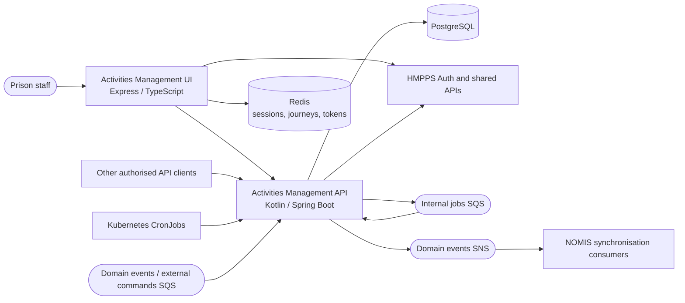

# 1. Architecture overview

## Status

Current implementation, recorded descriptively. Not a new architecture approval.

## Context

Prison staff need to create activities, manage waiting lists and allocations, record attendance,
and arrange individual, group and repeating appointments. Other services need scheduled-event
information and synchronisation data without going through the staff UI.

The service must also react to prisoner lifecycle changes and retain operational compatibility
with NOMIS while prisons and capabilities are rolled out independently.

## Implementation

The API owns business rules and persistent activities and appointments data. Spring MVC resources
delegate to services and domain entities; Spring Data JPA repositories provide persistence.
Flyway owns schema changes. `model/` request and response types are separate from persistence entities.
Although WebClient is used for downstream HTTP calls, this is not a wholly reactive WebFlux application.

The frontend owns server-rendered staff journeys, browser sessions and presentation. It also calls
shared APIs directly: it is not simply a proxy for this API. Redis belongs to the frontend's runtime;
the API uses PostgreSQL and small in-process caches, not a shared Redis cache.

See the [high-level design](high-level-design.md) for the component and dependency inventory and
the [data flow diagram](data-flow-diagram.md) for authentication and boundary crossings.

## Consequences

Business rules are reusable by the UI, API consumers, event handlers and jobs. These entry points
have different identities and controls: browser sessions, bearer JWTs, queue permissions and
ingress-protected job endpoints must not be treated as interchangeable.

Database changes and messages to AWS services are separate operations. Consumers and operations
must account for delayed or failed event delivery; a successful database update alone is not
proof that NOMIS is synchronised. Migration and reconciliation are described in
[document 2](02-nomis-sync-and-migration.md), and persistence in [document 3](03-activities-db-design.md).

## Sources

- [API resources](../src/main/kotlin/uk/gov/justice/digital/hmpps/hmppsactivitiesmanagementapi/resource),
  [services](../src/main/kotlin/uk/gov/justice/digital/hmpps/hmppsactivitiesmanagementapi/service) and
  [build configuration](../build.gradle.kts).
- [Frontend application composition](https://github.com/ministryofjustice/hmpps-activities-management/blob/main/server/app.ts)
  and [API client composition](https://github.com/ministryofjustice/hmpps-activities-management/blob/main/server/data/index.ts).

[Index](README.md) | [Next: NOMIS synchronisation](02-nomis-sync-and-migration.md)
