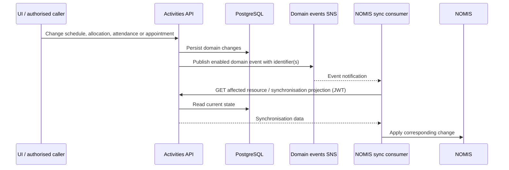

# 2. NOMIS synchronisation and migration

## Status

Current implementation, recorded descriptively. This is not a migration execution plan or approval
to run data-changing endpoints.

## Context

Activities and appointments must coexist with NOMIS. Migration imports initial records into this
service; outbound domain events identify later changes for downstream consumers. Dedicated read
endpoints expose the data needed for synchronisation and reconciliation.

Migration, ongoing synchronisation and inbound prisoner lifecycle processing are separate concerns.
The API does not write directly to the NOMIS database.

## Rollout and ownership

`RolloutPrisonService` derives each prison's plan from independently configured lists:

| Environment variable | Meaning |
| --- | --- |
| `ACTIVITIES_LIVE` | Activities rolled out at the prison |
| `APPOINTMENTS_LIVE` | Appointments rolled out at the prison |
| `EXTERNAL_ACTIVITIES_LIVE` | External activities rolled out at the prison |
| `PRISONS_LIVE` | Prison live to users |

The UI reads `/rollout/{prisonCode}` and refreshes the plan when the active caseload changes.
Do not infer that activities and appointments are live together or copy a prison list from this
document: environment Helm values are the source of truth.

This API owns activities and appointments managed here. Prisoner identity, location identity and
other shared data remain owned by their respective services. DPS UUIDs and numeric NOMIS location
IDs are both retained where required; `NomisMappingAPIClient` translates location identifiers.
The external NOMIS migration/synchronisation implementation and its mapping persistence are outside
this repository.

## Migration API surface

| Endpoint | Purpose | Required role(s), without `ROLE_` |
| --- | --- | --- |
| `POST /migrate/activity` | Import an activity, schedule, slots and applicable pay rates | `NOMIS_ACTIVITIES` |
| `POST /migrate/allocation` | Import a prisoner allocation | `NOMIS_ACTIVITIES` |
| `DELETE /migrate/delete-activity/prison/{prisonCode}/id/{activityId}` | Migration-support activity deletion | `NOMIS_ACTIVITIES` |
| `POST /migrate/{prisonCode}/move-activity-start-dates` | Migration-support start-date adjustment | `NOMIS_ACTIVITIES` or `ACTIVITY_ADMIN` |
| `POST /migrate-appointment` | Import an individual appointment and return its per-attendee instance | `NOMIS_APPOINTMENTS` |
| `GET /migrate-appointment/{prisonCode}/summary` | Summarise migrated appointments | `NOMIS_APPOINTMENTS` or `MIGRATE_APPOINTMENTS` |
| `DELETE /migrate-appointment/{prisonCode}` | Soft-delete selected migrated appointments | `NOMIS_APPOINTMENTS`, `ACTIVITY_ADMIN` or `MIGRATE_APPOINTMENTS` |
| `POST /rollout/prison-regime/{agencyId}` | Set migration-time regime slots | `MIGRATE_ACTIVITIES` |

These are not a generic upsert contract. Request validation, date limits, reference data, location
mapping and response semantics are defined by the controllers and migration services.
For example, activity migration checks rollout, incentive levels and a future start date.
Appointment migration can return no instance for a start date outside its configured horizon
(with category exceptions); callers must handle that contract rather than assuming every input
creates a record.

## Ongoing synchronisation

The sequence below is the logical consumer interaction supported by this API. The downstream
consumer's implementation, retries and NOMIS writes are outside this repository.

This is not a single distributed transaction. Transaction boundaries vary between operations, and
database commits and SNS publication are not atomic. A publication failure can leave committed data
without the expected event. Do not equate an HTTP response or a no-op data rerun with confirmed event
delivery. Use failed-event telemetry and reconciliation when investigating divergence.

### Outbound domain events

`OutboundEventsService` constructs events and `OutboundEventsPublisher` publishes them to the
logical SNS topic `domainevents`, with `eventType` as a message attribute.

| Event types | `additionalInformation` |
| --- | --- |
| `activities.activity-schedule.created`, `activities.activity-schedule.amended` | `activityScheduleId` |
| `activities.scheduled-instance.amended` | `scheduledInstanceId` |
| `activities.prisoner.allocated`, `activities.prisoner.allocation-amended` | `allocationId` |
| `activities.prisoner.attendance-created`, `activities.prisoner.attendance-amended`, `activities.prisoner.attendance-expired` | `attendanceId` |
| `activities.prisoner.attendance-deleted` | `bookingId`, `scheduledInstanceId` |
| `appointments.appointment-instance.created`, `.updated`, `.deleted`, `.cancelled`, `.uncancelled` | `appointmentInstanceId`, `categoryCode` |

The envelope contains `eventType`, `additionalInformation`, `version`, `description` and `occurredAt`.
Events are identifier-based, not complete resource snapshots. Booking IDs and other identifiers
are still sensitive even when names are absent.

Publication requires the global `FEATURE_EVENTS_SNS_ENABLED` switch and the relevant per-event
switch. Do not infer publication from a call to `send` alone. Deletion events can carry the
identifiers needed after the underlying resource is no longer available.

### Read and reconciliation endpoints

Consumers use role-authorised resource reads such as `/schedules/{scheduleId}`,
`/allocations/id/{allocationId}`, `/scheduled-instances/{instanceId}` and
`/appointment-instances/{appointmentInstanceId}`, alongside:

| Endpoint | Purpose |
| --- | --- |
| `GET /synchronisation/attendance/{attendanceId}` | Attendance synchronisation projection |
| `GET /synchronisation/reconciliation/allocations/{prisonId}` | Active allocation counts by booking |
| `GET /synchronisation/reconciliation/suspended-allocations/{prisonId}` | Suspended allocation counts by booking |
| `GET /synchronisation/reconciliation/attendances/{prisonId}?date=YYYY-MM-DD` | Paid attendance counts by booking and date |

The `/synchronisation` endpoints require `NOMIS_ACTIVITIES`. Appointment instance IDs are attendee
IDs exposed through `v_appointment_instance`, not appointment occurrence IDs.

## Inbound messaging

| Logical queue ID | Contract and purpose |
| --- | --- |
| `activities` | SNS notification envelope containing an HMPPS domain event; prisoner lifecycle and change-of-circumstances processing |
| `updatefromexternalsystemevents` | Direct command envelope with `eventType`, `who` and command-specific payload |
| `activitiesmanagementjobs` | Internal work envelope containing `jobId`, a `JobType` and `messageAttributes` |
| `audit` | Send-only HMPPS audit messages; separate from domain events |

`InboundEventsListener` recognises prisoner received, released, merged, updated and alerts-updated
events, incentives review inserted / updated / deleted events, non-association changes, and
NOMIS-originated activities-changed / appointments-changed events. Per-event switches determine
whether recognised events are processed. Handlers manage affected allocations and appointments
and/or create event-review information for staff.

These notifications are not a generic reverse-sync feed for all activity and appointment fields.
The external-command listener has a different purpose and supports:

- `MarkPrisonerAttendance`
- `DeallocatePrisonerFromActivitySchedule`
- `AllocatePrisonerToActivitySchedule`

It also accepts a no-op `TestEvent`. Commands invoke domain services, using the envelope's `who`
as the actor; allocation commands use the service's admin mode. Queue producer permissions and actor
attribution are therefore part of this interface's trust boundary, not the REST role checks.
The listener defines the accepted contract; which external producers are deployed is not established
by this repository.

The three consumed queues have DLQ wiring in Helm. Inspect the event type, feature switches,
job state, failure telemetry and downstream state before retrying or replaying messages. Messages
and operational logs can contain prisoner and staff identifiers.

## Sources

- [Migration controllers](../src/main/kotlin/uk/gov/justice/digital/hmpps/hmppsactivitiesmanagementapi/resource/MigrateActivityController.kt),
  [appointment migration controller](../src/main/kotlin/uk/gov/justice/digital/hmpps/hmppsactivitiesmanagementapi/resource/appointment/MigrateAppointmentController.kt),
  [activity migration service](../src/main/kotlin/uk/gov/justice/digital/hmpps/hmppsactivitiesmanagementapi/service/MigrateActivityService.kt)
  and [appointment migration service](../src/main/kotlin/uk/gov/justice/digital/hmpps/hmppsactivitiesmanagementapi/service/appointment/MigrateAppointmentService.kt).
- [Rollout service](../src/main/kotlin/uk/gov/justice/digital/hmpps/hmppsactivitiesmanagementapi/service/refdata/RolloutPrisonService.kt),
  [synchronisation controller](../src/main/kotlin/uk/gov/justice/digital/hmpps/hmppsactivitiesmanagementapi/resource/SynchronisationController.kt)
  and [synchronisation service](../src/main/kotlin/uk/gov/justice/digital/hmpps/hmppsactivitiesmanagementapi/service/SynchronisationService.kt).
- [Event contracts and publishers](../src/main/kotlin/uk/gov/justice/digital/hmpps/hmppsactivitiesmanagementapi/service/events),
  [external-command listener](../src/main/kotlin/uk/gov/justice/digital/hmpps/hmppsactivitiesmanagementapi/service/updatesfromexternalsystems/UpdateFromExternalSystemsEventsListener.kt),
  [feature switches](../src/main/kotlin/uk/gov/justice/digital/hmpps/hmppsactivitiesmanagementapi/config/FeatureSwitches.kt)
  and [queue deployment configuration](../helm_deploy/hmpps-activities-management-api/values.yaml).

[Previous: Architecture](01-architecture.md) | [Index](README.md) | [Next: Database design](03-activities-db-design.md)
