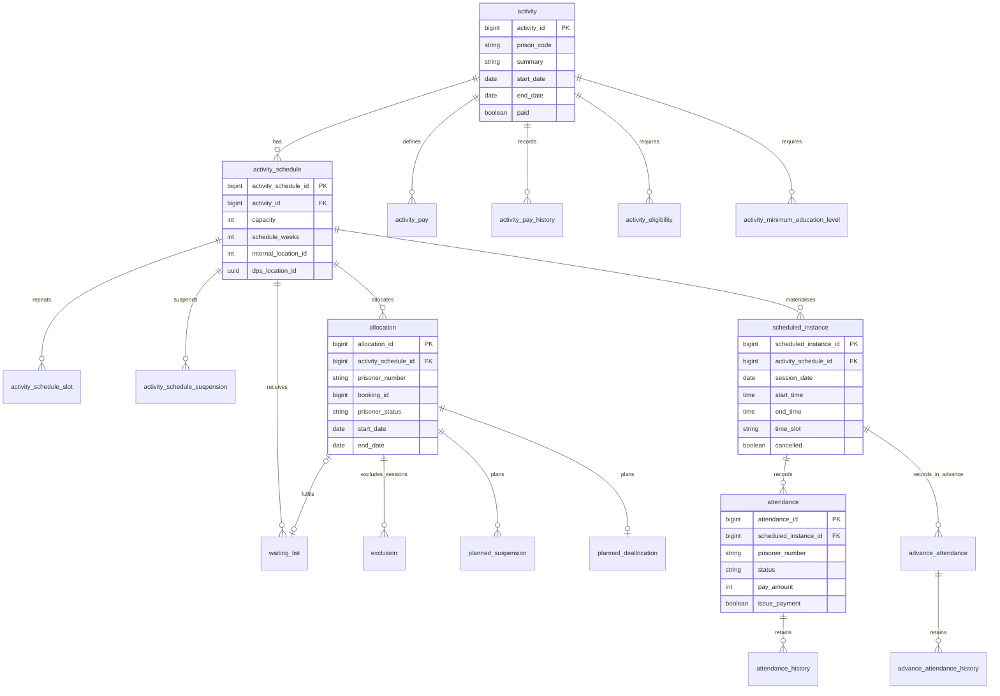
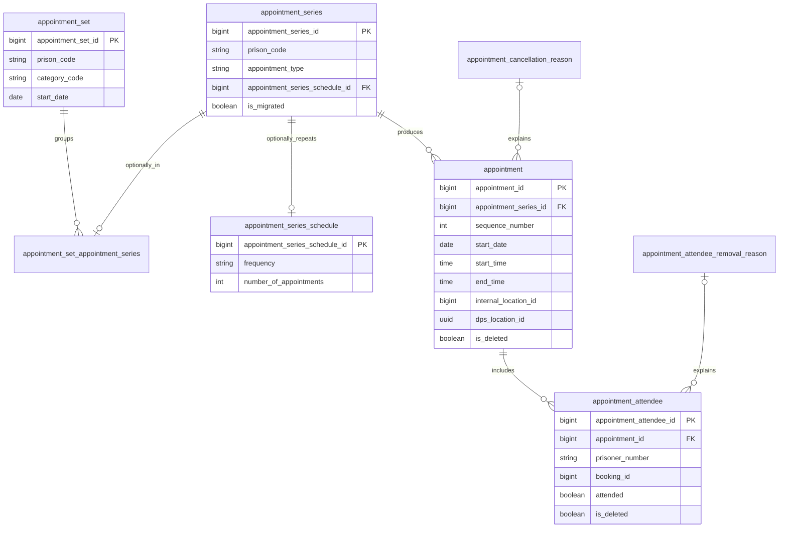

# 3. Database design for activities and appointments

## Status

Current implementation, recorded descriptively. The diagrams are selected logical relationships,
not a proposed schema or an exhaustive database export.

## Context

Activities and appointments have different lifecycle models. Activities require recurring schedules,
prisoner allocations, exclusions and payable attendance. Appointments require sets, repeating series,
dated occurrences and individual attendees. Both need history, staff attribution and synchronisation
identifiers.

## Persistence

PostgreSQL is accessed through Hibernate / Spring Data JPA. Flyway owns schema evolution:
`generate-ddl` is false and `ddl-auto` is `none`. The default Flyway locations are
`migrations/common` and `migrations/prod`; development profiles can change the migration locations.
Repeatable `R__*.sql` migrations maintain read views alongside versioned schema migrations.

Domain objects and API models are separate. Several `@Entity` classes map to immutable views;
an entity class is therefore not necessarily a writable table.

## Activities

An **activity** defines what is offered, its dates, category, tier, eligibility and pay rates.
A **schedule** defines capacity, location and a weekly cycle; slots define the days and times within
that cycle. A **scheduled instance** is one dated session, with its own cancellation state.

An **allocation** links a prisoner to a schedule over a date range. It stores prisoner number and
booking ID, status and pay band, with planned deallocation, planned suspensions and session exclusions.
A **waiting-list application** belongs to an activity and schedule and can link to the resulting
allocation.

An **attendance** belongs to a scheduled instance and identifies the prisoner by number. It is not
a direct foreign key to an allocation or a local prisoner master table. Attendance stores recording
details, reasons, comments, payment decisions and case-note references. Advance attendance is stored
separately, with its own history.

Prison pay bands, categories, eligibility rules, attendance reasons, tiers, organisers and prison
regime slots are reference data. They are omitted from the relationship diagram for readability.

## Appointments

A **set** groups series, using `appointment_set_appointment_series`; a series does not need to
belong to a set. A **series** contains shared creation / recurrence information, with an optional
series schedule. Each **appointment** is a dated occurrence and can hold amended details separately
from the series header. Each **attendee** records a prisoner's inclusion, attendance and removal.

Cancellation and deletion are distinct. Appointments and attendees retain soft-deletion flags and
reason references. Application accessors and read views filter deleted rows; removing an item from
the visible UI does not necessarily physically remove it from PostgreSQL.

### Appointment instance identity

`v_appointment_instance` joins series, appointments and attendees into the per-prisoner projection
used by synchronisation. Its `appointment_instance_id` is the **appointment attendee ID**.
A group appointment with several attendees therefore exposes several instances. It is not a
separate writable `appointment_instance` table, and its ID must not be confused with `appointment_id`.
The view filters soft-deleted appointments and attendees.

## Read models, history and operational data

| Area | Examples and purpose |
| --- | --- |
| Scheduling / attendance views | `v_prisoner_scheduled_activities`, `v_attendance_creation_data`, `v_attendance_sync` |
| Appointment views | `v_appointment_instance` and appointment search / summary projections |
| Subject-access-request views | `v_sar_allocation`, `v_sar_appointment`, `v_sar_waiting_list` |
| Explicit history | Attendance and advance-attendance history, activity pay history, prisoner history and schedule-change impact |
| Envers history | Selected audited entities and fields; `_aud` tables and custom revision metadata |
| Local audit | `local_audit`, separate from HMPPS audit messages sent to SQS |
| Operational processing | `job`, daily statistics and event-review records |

Not every entity or field is Envers-audited. Explicit history tables, local audit records and HMPPS
audit messages serve different purposes and should not be treated as interchangeable copies.

## Identifiers and data sensitivity

Prisoner numbers and booking IDs are external identifiers stored with operational records, not
foreign keys into a locally owned prisoner identity table. Responses can additionally include names
and other information fetched from Prisoner Search and other APIs.

Location-bearing schedules and appointment headers / occurrences can store both a numeric
`internal_location_id` for NOMIS compatibility and a `dps_location_id` UUID. Those values represent
the same external location in different systems, not interchangeable types. Schedules also cache
location code and description. Location master data remains in the Locations service.

Staff usernames, waiting-list and attendance comments, appointment free text and prisoner-specific
information are persisted too. These tables, views, history, exports and audit records require
appropriate handling; this is not a reference-data-only database.

## Constraints and change considerations

Domain methods enforce lifecycle and date rules, supplemented by database constraints and indexes.
For example, advance attendance has a unique `(scheduled_instance_id, prisoner_number)` index.
The non-ended-allocation exclusion constraint uses schedule, prisoner number, start date and status;
it must not be described as a blanket prohibition on all overlapping allocations.

When changing persistence, update Flyway migrations, entity mappings, native queries and relevant
repeatable views together. Check API response models, NOMIS projections, reporting and SAR read
models as well as direct CRUD paths. Do not rely on Hibernate to create or alter the deployed schema.

## Sources

- [Entities](../src/main/kotlin/uk/gov/justice/digital/hmpps/hmppsactivitiesmanagementapi/entity),
  [repositories](../src/main/kotlin/uk/gov/justice/digital/hmpps/hmppsactivitiesmanagementapi/repository)
  and [Flyway migrations](../src/main/resources/migrations).
- [JPA / Flyway configuration](../src/main/resources/application.yml)
  and [appointment-instance view](../src/main/resources/migrations/common/R__v_appointment_instance.sql).
- [Advance-attendance migration](../src/main/resources/migrations/common/V2025.05.12__create_advance_attendance_table.sql)
  and [allocation constraint](../src/main/resources/migrations/common/V2025.02.03__add_unique_constraint_to_allocations.sql).

[Previous: NOMIS synchronisation](02-nomis-sync-and-migration.md) | [Index](README.md) | [Next: Cron jobs](04-cron-jobs.md)
