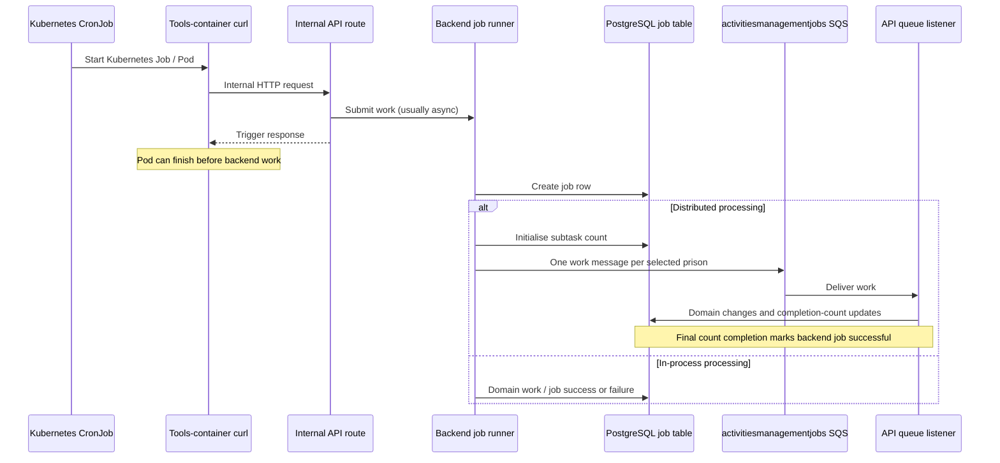
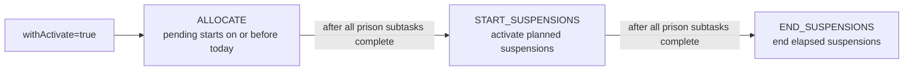

# 4. Cron jobs and scheduled processing

This document describes the Kubernetes CronJobs defined in the API's
[Helm templates](../helm_deploy/hmpps-activities-management-api/templates), their backend processing,
and how to distinguish trigger success from completed work. Schedules reflect checked-in
configuration, not a verification of live cluster state.

## Scheduling and environment overrides

Most schedules come from the chart's [`cron` values](../helm_deploy/hmpps-activities-management-api/values.yaml).
[Dev values](../helm_deploy/values-dev.yaml) override some of them; preprod and prod currently inherit
the chart defaults. Metrics and queue-housekeeping schedules are hard-coded in their templates.

No template sets `spec.timeZone`. Kubernetes therefore interprets schedules in the controller
manager's local time zone. The times below are **schedule-clock times**, not a guarantee of UK
local time or daylight-saving adjustment. Check the cluster time zone before planning an intervention.

All triggers use the internal base URL `http://hmpps-activities-management-api`. Paths in the table
are HTTP `POST` unless otherwise stated. The key column is relative to `cron`.

| Kubernetes CronJob name | Schedule key | Default / preprod / prod | Dev | Trigger path and arguments |
| --- | --- | --- | --- | --- |
| `deallocate-allocations-ending` | `allocationsDeallocateEnding` | `0 1 * * *` - daily 01:00 | `30 6 * * *` - daily 06:30 | `/job/manage-allocations?withDeallocateEnding=true` |
| `fix-stuck-auto-suspended` | `allocationsFixAutoSuspended` | `45 1 * * *` - daily 01:45 | `45 20 * * *` - daily 20:45 | `/job/manage-allocations?withFixAutoSuspended=true` |
| `activate-allocations` | `allocationsActivate` | `0 2 * * *` - daily 02:00 | `45 6 * * *` - daily 06:45 | `/job/manage-allocations?withActivate=true` |
| `manage-appointment-attendees` | `appointmentAttendees` | `30 2 * * *` - daily 02:30 | `45 6 * * *` - daily 06:45 | `/job/appointments/manage-attendees?daysAfterNow=14` |
| `create-scheduled-instances` | `createScheduledInstances` | `0 3 * * *` - daily 03:00 | `0 7 * * *` - daily 07:00 | `/job/create-scheduled-instances` |
| `activities-metrics` | Hard-coded | `0 3 * * *` - daily 03:00 | Same | `/job/activities-metrics` |
| `appointments-metrics` | Hard-coded | `0 3 * * *` - daily 03:00 | Same | `/job/appointments-metrics` |
| `manage-attendance-records` | `attendanceRecords` | `0 4 * * *` - daily 04:00 | `15 7 * * *` - daily 07:15 | `/job/manage-attendance-records?withExpiry=true` |
| `fix-activity-locations` | `fixActivityLocations` | `30 4 * * *` - daily 04:30 | Same | `/job/fix-locations` |
| `deallocate-allocations-expiring` | `allocationsDeallocateExpiring` | `0 22 * * *` - daily 22:00 | `30 20 * * *` - daily 20:30 | `/job/manage-allocations?withDeallocateExpiring=true` |
| `purposeful-activity-reports` | `purposefulActivityReports` | `30 1 * * 2` - Tuesday 01:30 | `30 8 * * 2` - Tuesday 08:30 | `/job/purposeful-activity-reports` |
| `hmpps-activities-management-api-queue-housekeeping` | Hard-coded | `*/10 * * * *` - every 10 minutes | Same | **PUT** `/queue-admin/retry-all-dlqs` |
| `remap-non-residential-locations` | `locationRemap.schedule` | `0 9 * * 1-4` - Monday-Thursday 09:00, **disabled and suspended by default** | Same | `/job/remap-non-residential-locations`, form fields `file`, `prisons`, `dryRun` |

Clock spacing is not an execution dependency. For example, schedule generation and metrics share
03:00 by default, while attendance creation is scheduled later but does not wait on Kubernetes
completion of the schedule-generation job.

## Trigger and worker lifecycle



The diagram represents the usual asynchronous trigger. Purposeful-activity reporting is an
exception: its controller uses `runBlocking` and waits for the in-process runner. Queue housekeeping
is provided by the HMPPS SQS library, not `SafeJobRunner`.

`JobsSqsListener` processes the internal jobs queue with `maxMessagesPerPoll=6` and
`maxConcurrentMessages=6` per listener instance. Backend work can therefore continue across API pods
after the trigger Pod has exited.

### Kubernetes execution policies

| Policy | Routine jobs | Queue housekeeping | Optional location remap |
| --- | --- | --- | --- |
| `concurrencyPolicy` | `Replace` | `Forbid` | `Forbid` |
| `startingDeadlineSeconds` | 43200 (12 hours) | 600 (10 minutes) | 300 (5 minutes) |
| `backoffLimit` | 2 | Not set in template; Kubernetes default applies | 0 |
| Pod `activeDeadlineSeconds` | 3600 (1 hour) | Not set | 3600 (1 hour) |
| `restartPolicy` | `Never` | `Never` | `Never` |
| Successful / failed Job history | 5 / 5 | 5 / 5 | 5 / 5 |
| Finished Job TTL | 345600 seconds (4 days) | Same | Same |
| curl behaviour | `--fail --retry 2` | `--retry 2`, **without `--fail`** | `--fail-with-body --silent --show-error`, no retry |

These policies govern Kubernetes trigger Jobs, not already-submitted backend work. `Replace` does
not cancel an API task or its SQS messages, and `Forbid` does not prevent overlap after an asynchronous
trigger exits. Only the location-remap implementation shown here also takes a database advisory
lock to prevent concurrent backend remaps.

Retries can resubmit triggers. Do not assume exactly-once processing or that every job is safe to
rerun without checking its effects. Housekeeping's curl command can exit successfully for an HTTP
error response because it omits `--fail`; inspect the API response / logs as well as Pod status.

## Processing behaviour

### Allocation lifecycle

**Ending allocations** (`DEALLOCATE_ENDING`) fan out per rollout prison. The service examines end
dates from three days ago through yesterday by default
(`jobs.deallocate-allocations-ending.days-start`). It ends allocations due on those dates; when a
schedule ends, it also declines pending / approved waiting-list applications. Changed allocations
produce allocation-amended domain events.

**Expiring allocations** (`DEALLOCATE_EXPIRING`) are different from planned end dates. The service
uses Prisoner Search and Prison API movement history to find prisoners absent from the expected
prison beyond the plan's expiry threshold. It considers pending and auto-suspended allocations and
also removes expired open waiting-list applications.

**Activation** starts a distributed chain:



Pending allocations are activated when Prisoner Search shows the prisoner active in the allocation's
prison, otherwise auto-suspended. A missing prisoner is logged. Suspension and unsuspension are
follow-on backend jobs, not separate CronJobs. Each stage has its own database job row.

**Stuck auto-suspensions** (`FIX_STUCK_AUTO_SUSPENDED`) run in-process with the retry-enabled runner.
The service checks auto-suspended allocations against Prisoner Search and invokes the prisoner-received
handler when the prisoner is active in the expected prison.

### Scheduled instances

`SCHEDULES` fans out per rollout prison and creates missing dated instances for activity schedules.
The configured horizon is `SCHEDULE_AHEAD_DAYS` (60 in chart defaults): the date range starts today
and excludes the end date `today + daysInAdvance`. The service publishes schedule-amended events
for schedules it changes.

Each schedule is processed in its own transaction. Individual schedule failures are logged and
captured by monitoring while processing continues, so a completed prison subtask does not prove that
every schedule was updated successfully.

### Attendance creation and expiry

`ATTENDANCE_CREATE` fans out for activities-rolled-out prisons and creates attendance for the
requested date, defaulting to today. The endpoint accepts optional `prisonCode`, `date` and
`withExpiry` parameters; the CronJob supplies only `withExpiry=true`. The job does not create
attendance for a future date.

When creation's final prison subtask completes with expiry requested, it starts a separate
`ATTENDANCE_EXPIRE` distributed job. Expiry finds yesterday's `WAITING` attendances and publishes
`activities.prisoner.attendance-expired` events for NOMIS synchronisation. **It does not change local
attendance state.** Its date is yesterday relative to the execution clock, not the creation request's
optional `date`. Per-attendance publishing failures are logged while processing continues.

### Appointment attendees

`MANAGE_APPOINTMENT_ATTENDEES` fans out per rollout prison, including prisons whose appointments
flag is not enabled because migrated appointments may still need maintenance. The CronJob uses
`daysAfterNow=14`; the service accepts values in `0..60`.

The service identifies prisoners in appointments from today through the requested horizon, checks
Prisoner Search and movement history, and removes future appointment attendance for permanent
releases or moves beyond the expiry threshold. The horizon selects candidate prisoners; removal
can affect their future appointments beyond that candidate window.

### Metrics

`ACTIVITIES_METRICS` runs in-process asynchronously and emits Application Insights daily statistics
for live prisons, broken down by activity tier and category. It includes activity, allocation,
waiting-list and attendance measures, using yesterday for the date-specific calculations.

`APPOINTMENTS_METRICS` also runs in-process asynchronously, aggregating yesterday's appointments
and recorded attendance by live prison and appointment category, and emitting Application Insights
metrics. Neither metrics job uses the internal jobs queue.

### Location repair

Despite the Kubernetes name `fix-activity-locations` and broad endpoint description, the current
`FixLocationsJob` runs **three appointment-location repairs**, sequentially:
`FIX_APPOINTMENT_SERIES_LOCATIONS`, `FIX_APPOINTMENT_SET_LOCATIONS` and
`FIX_APPOINTMENT_LOCATIONS`. It does not call an activity-schedule repair.

Each repair finds numeric NOMIS location references missing a DPS UUID, resolves the mapping and
checks the location through the Locations API, then updates stored location details. Lookup failures
are warned and skipped, so review residual missing UUIDs as well as job success. This routine repair
is distinct from the CSV-driven location remap.

### Purposeful-activity reports

`PURPOSEFUL_ACTIVITY_REPORTS` runs in-process and generates **activity and appointment CSV exports**
through `PurposefulActivityService`, then uploads them to Analytical Platform S3. The current service
calls two report generators; the controller's description of a third rollout report should not be
taken as an implemented third export.

The endpoint accepts `weekOffset`, defaulting to 1 (the reporting week ending on the prior Saturday).
Increasing the offset selects an earlier week. Temporary files are deleted after successful upload.
Inspect the backend job result and expected S3 objects; a controller response alone is not sufficient,
because `SafeJobRunner` records and logs exceptions instead of propagating them to the caller.

### Queue housekeeping

Every ten minutes, `PUT /queue-admin/retry-all-dlqs` asks the HMPPS SQS library to retry configured
DLQs. This is automatic replay, not a cleanup that discards failed business messages. Inspect repeated
failures and queue depth rather than relying on replay to resolve a persistent processing problem.
No application `JobType` / `job` row is created by the CronJob's own implementation.

### Optional CSV location remap

The template is rendered only with `cron.locationRemap.enabled=true`; it is suspended by default,
requires a non-empty `file` value, and defaults to `dryRun=true`. Its fallback schedule does not
constitute permission to run it.

Data-changing runs additionally require the API's approved-filename configuration. The backend
uses `REMAP_NON_RESIDENTIAL_LOCATIONS` and a database advisory lock. Follow the
[location-remap runbook](../README.md#temporary-non-residential-location-remap-saa-4624) for approvals,
environment-specific mappings, dry runs, one-off Jobs and reconciliation. Do not substitute the
routine location-repair procedure for that runbook.

## Completion, failures and operational checks

There are three separate observations:

1. **Kubernetes trigger:** was the CronJob scheduled, did its Pod run, and did curl receive a successful
   response? This usually confirms submission only.
2. **Backend job:** find its job ID in API logs and inspect `job_type`, `started_at`, `ended_at`,
   `successful`, `total_sub_tasks` and `completed_sub_tasks` in the `job` table. Distributed jobs finish
   through count updates; an unfinished row can indicate pending, failed or stuck subtasks.
3. **Business outcome:** inspect domain data, per-item warnings, failure telemetry and outbound-event
   delivery / NOMIS reconciliation or S3 exports as applicable. Some services continue after individual
   failures, and counters are not a guarantee of complete business success.

`SafeJobRunner` marks in-process failures unsuccessful and reports them through monitoring. It also
records distributed dispatch failures, while worker failures may leave the parent job incomplete.
Queue retries and DLQs must therefore be checked alongside the database row.

Read-only Kubernetes inspection commands, after choosing the correct namespace:

```sh
kubectl -n "$NAMESPACE" get cronjobs
kubectl -n "$NAMESPACE" describe cronjob create-scheduled-instances
kubectl -n "$NAMESPACE" get jobs --sort-by=.metadata.creationTimestamp
```

Before any rerun, establish whether backend work is still active, what has already committed, and
whether the required action is data repair or event replay. Replacing or suspending a CronJob stops
future triggers, not work already running in API pods or queued in SQS.

The trigger routes deliberately bypass application JWT authentication and are denied at external
ingress. Call them only through the intended internal operational path. Preserve that boundary
when modifying Helm or security configuration.

## Implementation sources

- [CronJob templates](../helm_deploy/hmpps-activities-management-api/templates),
  [base values](../helm_deploy/hmpps-activities-management-api/values.yaml),
  [dev overrides](../helm_deploy/values-dev.yaml),
  [preprod values](../helm_deploy/values-preprod.yaml) and [prod values](../helm_deploy/values-prod.yaml).
- [Job trigger controller](../src/main/kotlin/uk/gov/justice/digital/hmpps/hmppsactivitiesmanagementapi/resource/JobTriggerController.kt)
  and [appointment job controller](../src/main/kotlin/uk/gov/justice/digital/hmpps/hmppsactivitiesmanagementapi/resource/appointment/AppointmentJobController.kt).
- [Job implementations](../src/main/kotlin/uk/gov/justice/digital/hmpps/hmppsactivitiesmanagementapi/job),
  [SafeJobRunner](../src/main/kotlin/uk/gov/justice/digital/hmpps/hmppsactivitiesmanagementapi/job/SafeJobRunner.kt),
  [job entity and types](../src/main/kotlin/uk/gov/justice/digital/hmpps/hmppsactivitiesmanagementapi/entity/Job.kt)
  and [completion tracking](../src/main/kotlin/uk/gov/justice/digital/hmpps/hmppsactivitiesmanagementapi/service/JobService.kt).
- [Domain services](../src/main/kotlin/uk/gov/justice/digital/hmpps/hmppsactivitiesmanagementapi/service)
  and [event delivery contracts](02-nomis-sync-and-migration.md).

[Previous: Database design](03-activities-db-design.md) | [Index](README.md) | [Next: External API calls](05-external-api-calls.md)
