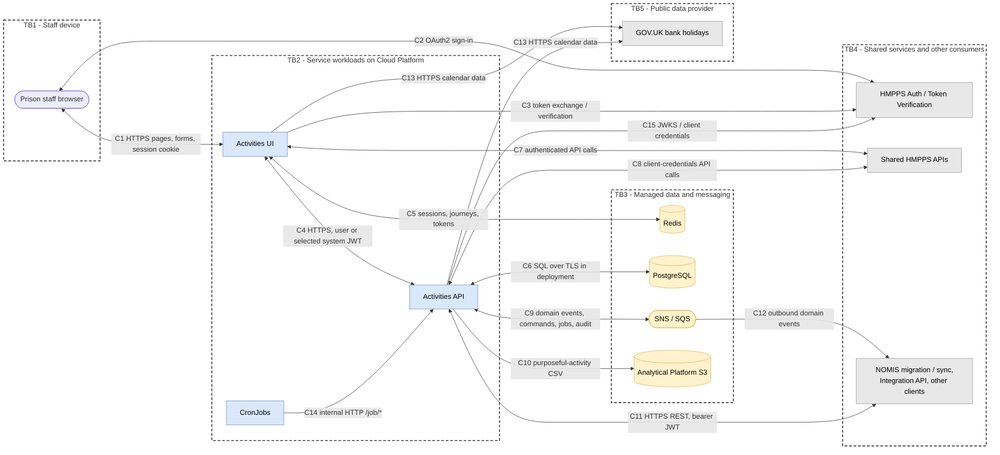
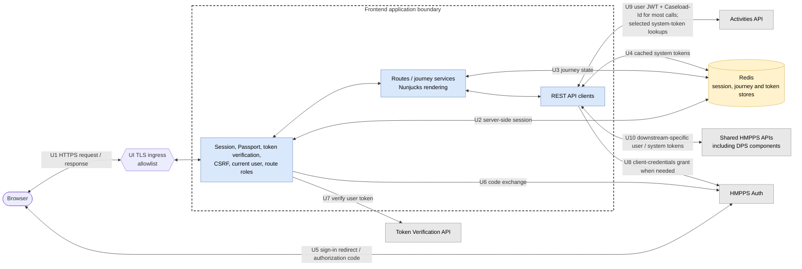
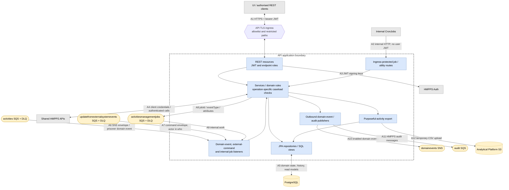
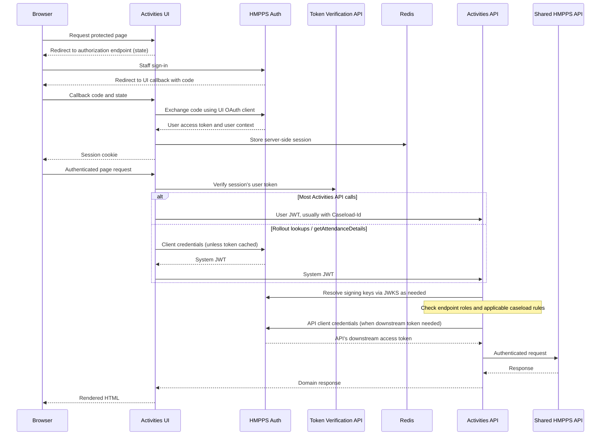

# Data flow diagram - Activities and appointments

These diagrams show data movement through the API and frontend, including the trust boundaries
relevant to threat modelling. They document interfaces and controls, not findings from a security
assessment. See the [high-level design](high-level-design.md) for component responsibilities.

## How to read the diagrams

Dashed boxes identify trust boundaries. Blue nodes are service-owned processes, yellow nodes are
stores or messaging infrastructure, and grey nodes are dependencies outside this service's ownership.
Boundaries are logical: workloads running in the same cluster do not automatically share an identity
or authorisation context. HTTPS ingress and internal HTTP job calls are distinguished explicitly.

Flows use stable prefixes: `C` for context, `U` for UI and `A` for API. Arrow labels describe the
request or publication; responses normally return along the same connection. No claim is made here
about external producers' authentication or infrastructure that is not configured in these repositories.

## Context

`C9` is decomposed below: the queues do not all accept the same envelope or have the same producer.
`C11` shows authorised consumers of this API, not direct access from arbitrary external organisations.
Any external gateway's consumer-authentication scheme is outside this documentation's verified scope.

## UI layer

The browser posts form data, including prisoner selections and free text, to the UI rather than
calling the Activities API directly in the normal staff journey. Session and journey stores can
contain prisoner information as well as staff identity and bearer tokens. Redis is not just a
cache of non-sensitive reference data.

The UI reads active-caseload information through the DPS components integration. Route-specific
`ROLE_ACTIVITY_HUB` checks protect selected activity-management journeys, and rollout middleware
controls feature availability. These UI checks complement, rather than replace, API authorisation.
The frontend has a Digital Prison Reporting API URL configured, but no reporting route is wired
in the inspected route composition, so no active reporting flow is drawn here. This configuration
is not a UI connection to the activities database.

## API layer

The diagram omits in-process calls that do not cross a boundary. API outbound HTTP clients acquire
client-credentials tokens from HMPPS Auth; the GOV.UK bank-holiday request is unauthenticated.
Queue traffic is governed by AWS permissions rather than REST bearer-token checks.

## Trust boundaries and significant data

| Crossing | Data / identity | Control or dependency |
| --- | --- | --- |
| Browser to UI (`C1`, `U1`) | Session cookie, form submissions, rendered prisoner / staff information | TLS ingress and allowlist; sessions, CSRF and web-security middleware |
| Sign-in and verification (`C2-C3`, `U5-U8`) | Authorization code, state, user token, client credentials | HMPPS Auth, Passport OAuth2 state, server-side token handling and Token Verification |
| UI / other clients to API (`C4`, `C11`, `U9`, `A1`) | JWT, prison context, prisoner identifiers and domain data | JWT validation and endpoint roles; caseload comparison where invoked |
| UI to Redis (`C5`, `U2-U4`) | Sessions, journeys and tokens | Redis credentials and configured TLS; independent of API database controls |
| API to PostgreSQL (`C6`, `A5`) | Operational prisoner data, staff usernames, comments, history | Database credentials and deployed `verify-full` TLS; Flyway-managed schema |
| Calls to shared APIs (`C7-C8`, `U10`, `A4`) | Prisoner / booking / location identifiers and enriched responses | Per-service token choice and downstream authorisation |
| Inbound queues (`A6-A9`) | Prisoner events, actor-attributed commands and internal work | AWS producer / consumer permissions, envelope parsing, handlers, validation and DLQs |
| Outbound messaging (`A10-A11`) | Resource IDs, booking IDs, category codes, audit actor and details | AWS permissions and publication switches; separate domain and audit contracts |
| Reporting (`C10`, `A12`) | Operational CSV exports | S3 permissions and upload encryption configuration; database reporting access is separately configured |
| Internal job routes (`C14`, `A2`) | Job triggers and maintenance parameters | Ingress denies restricted paths; application JWT authentication deliberately bypassed |
| Public calendar (`C13`) | Bank-holiday data | HTTPS public endpoint; no prisoner data required |

Prisoner data is both persisted and transiently enriched here. Free text, Redis journey data, reports,
audit details, telemetry and diagnostic logs must be included when assessing data exposure, not just
REST responses and primary tables.

## Authentication and token flow

This is a representative sequence, not a promise that every request exchanges or verifies tokens
over the network: session handling, key caching and token caching avoid some calls.
External-command attribution instead comes from `who`; it is not established by this browser flow.

## Sources and scope

The [high-level design sources](high-level-design.md#implementation-sources) link to API security,
caseload checking, frontend authentication and deployment configuration.
[Document 2](02-nomis-sync-and-migration.md) links the message contracts and listeners.
These diagrams do not assert the upstream Integration API gateway controls, exact deployed queue
policies, consumer inventory or NOMIS write implementation; those require the owning systems'
configuration.
