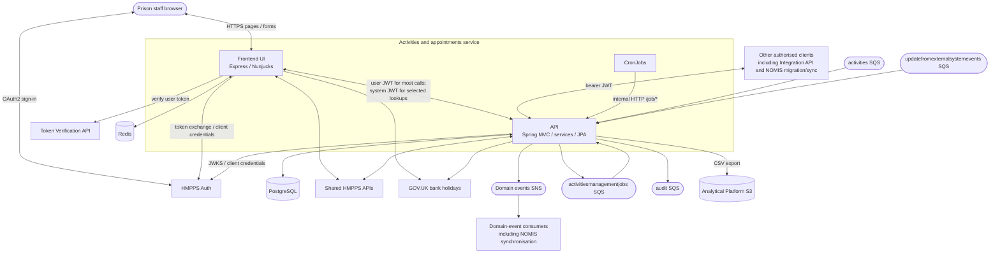

# High-level design - Activities and appointments

This service manages prisoner activities and appointments. This document describes the API and
its staff-facing UI; [data flows](data-flow-diagram.md), [NOMIS synchronisation](02-nomis-sync-and-migration.md)
and [database design](03-activities-db-design.md) provide the detailed views.

## Components

| Component | Responsibility |
| --- | --- |
| [Activities Management API](https://github.com/ministryofjustice/hmpps-activities-management-api) | Kotlin / Spring Boot; business rules, persistence, REST endpoints, event processing and jobs |
| [Activities Management UI](https://github.com/ministryofjustice/hmpps-activities-management) | Node.js / TypeScript / Express; staff journeys rendered with Nunjucks and GOV.UK Frontend |
| PostgreSQL / RDS | Activities, allocations, attendances, appointments, reference data and history |
| Redis / ElastiCache | Frontend sessions, journey state and cached system tokens |
| SNS / SQS | Outbound domain events, inbound domain events, external commands, distributed jobs and audit |
| Kubernetes CronJobs | Call internal API endpoints to start scheduled maintenance and reporting |
| Analytical Platform S3 | Destination for purposeful-activity CSV exports |

## Container diagram

Arrows are logical dependencies, not a statement that all calls share a protocol or network route.
The [data flow diagram](data-flow-diagram.md) identifies individual crossings.

## Responsibilities

### API

| Area | Main responsibilities |
| --- | --- |
| `resource/` | REST contracts, validation and endpoint-specific role checks; includes migration, synchronisation and integration surfaces |
| `service/` | Activities, scheduling, allocations, waiting lists, attendance, suitability, event review, auditing and reporting |
| `service/appointment/` | Appointment sets, series, occurrences, attendees, cancellation and bulk operations |
| `entity/`, `repository/` | Domain state, persistence rules, queries and database-backed read models |
| `service/events/` | Consume prisoner domain events; publish activity and appointment domain events |
| `service/updatesfromexternalsystems/` | Consume explicit attendance and allocation commands |
| `job/` | Scheduled work, distributed queue processing, asynchronous appointment operations and job execution tracking |
| `client/` | Authenticated downstream HTTP clients and generated API models |

Activities have schedules and dated instances. Prisoners are allocated to schedules, and attendance
is recorded against an instance and prisoner. Appointment sets group series; a series produces
dated appointments, each with attendees. The synchronisation-facing appointment instance is a
per-attendee read model, not another independently managed appointment aggregate.

### Frontend

The UI composes authentication, session, CSRF, web-security, current-user and route-authorisation
middleware before the journey routes. Controllers and services call API clients and render
Nunjucks views. Multi-step journey state is stored in Redis, separately from persistent domain data.

The UI also assembles prisoner information and scheduling context directly from shared APIs,
and supports video-link bookings. Digital Prison Reporting has URL configuration, but no reporting
route is wired in the inspected frontend route composition. The UI has no direct connection to the
activities PostgreSQL database.

## Authentication and authorisation

The UI uses Passport's OAuth2 **authorization code grant** against HMPPS Auth. User tokens remain
server-side in the session; the browser receives a session cookie. Token Verification is used by
the frontend authentication middleware. Current-user setup requires `authSource === 'nomis'`.

**Most frontend calls to this API use the signed-in user's token** (`asUser(user.token)`), usually
with the active prison in `Caseload-Id`. The current `ActivitiesApiClient` uses `asSystem()` for
rollout-plan lookups, the rolled-out-prisons list and `getAttendanceDetails`. Do not assume the
Locations UI's system-token-for-all-calls pattern applies here.

The API validates bearer JWTs using HMPPS Auth's JWKS endpoint and applies `@PreAuthorize` checks.
The principal role groups include:

| Authority (with `ROLE_` prefix) | Purpose |
| --- | --- |
| `PRISON` | General prison-facing reads and attendance / appointment operations, depending on endpoint |
| `ACTIVITY_HUB` | Activity creation, allocation management, waiting-list changes and event review |
| `ACTIVITY_ADMIN` | Administration and many operational endpoints |
| `NOMIS_ACTIVITIES`, `NOMIS_APPOINTMENTS` | Migration and/or synchronisation contracts for the relevant domain |
| `MIGRATE_ACTIVITIES`, `MIGRATE_APPOINTMENTS` | Selected migration-support operations |
| `ACTIVITIES_MANAGEMENT__RO` | Selected read-only consumer endpoints |
| `ACTIVITIES__HMPPS_INTEGRATION_API` | Dedicated `/integration-api` endpoints |

This is a guide, not a role hierarchy or a complete permissions matrix: individual controller
annotations are authoritative. Unlike the reference Locations service, these controllers do not
uniformly add a separate `SCOPE_write` check to writes.

Where services call `checkCaseloadAccess`, a user token without `ACTIVITY_ADMIN` must supply a
`Caseload-Id` matching the target prison. Client tokens without a username and activity-admin tokens
bypass that comparison. This helper checks request context; it does not fetch a user's caseload
membership from NOMIS. The UI obtains caseload data through its shared DPS components integration.
Checks are applied at specific service operations, not globally to every API route.

API-to-API downstream calls use the API's configured OAuth2 client-credentials registrations.
`/job/**`, `/utility/**` and `/queue-admin/retry-all-dlqs` are exempted from application authentication
and blocked by the API ingress configuration. Their protection depends on that deployment boundary;
internal callers do not present a browser session or user JWT.

## External dependencies

See the [outbound API reference](05-external-api-calls.md) for backend endpoint paths, request data,
usage, authentication, timeout and retry behaviour. The table below also distinguishes frontend calls.

| Dependency | API usage | Additional frontend usage |
| --- | --- | --- |
| HMPPS Auth | JWT signing keys and client-credentials tokens | Staff sign-in and system tokens |
| Prison API | Prisoner / prison context and scheduled events | Caseload integration, prisoner images, pay profiles and reference information |
| Prisoner Search API | Prisoner lookup and enrichment | Prisoner search and journey context |
| Non-Associations API | Suitability and conflicts | Journey checks |
| Incentives API | Incentive levels and pay / suitability context | Journey information |
| Locations Inside Prison API | Location details and validation | Location selection and availability context |
| NOMIS Mapping API | DPS / NOMIS location ID translation | URL and health check configured; no client in the data-access composition |
| Case Notes API | Read / write case-note integration for domain operations | Case-note journeys |
| Manage Adjudications API | Adjudication information | Not an API client in the UI data-access composition |
| External Movements API | External-movement information for scheduled events | Obtained through API scheduling responses |
| GOV.UK bank holidays | Scheduling calendar | Calendar information |
| Alerts API, Book A Video Link API | Not direct API clients | Alerts and video-link booking journeys |
| Manage Users API, Frontend Components API | Not direct API clients | User information and shared DPS navigation / caseload integration |
| Token Verification API | No direct client configured here | User-token verification |
| Digital Prison Reporting | Database reporting access configured with a dedicated database user | Reporting API URL configured; no active reporting route found |

The [API WebClient configuration](../src/main/kotlin/uk/gov/justice/digital/hmpps/hmppsactivitiesmanagementapi/config/WebClientConfiguration.kt)
and [frontend configuration](https://github.com/ministryofjustice/hmpps-activities-management/blob/main/server/config.ts)
are authoritative for URLs and timeouts.

## Data, events and jobs

**Stored:** prisoner numbers and booking IDs, allocations, attendance and payment-related decisions,
waiting-list comments, appointment information including free text, staff usernames, history and audit
records. Unlike the Locations service, this API persists prisoner-related operational data.
Names and other prisoner context are also fetched from downstream services to enrich responses.

**Cached:** bank holidays and prison incentive levels in per-pod in-process API caches, evicted on
seven-day and one-day schedules respectively. Frontend Redis holds sessions, journey data and tokens,
and must also be treated as a sensitive store.

**Messaging:** the API publishes to the `domainevents` SNS topic and uses four logical SQS queue IDs:
`activities`, `updatefromexternalsystemevents`, `activitiesmanagementjobs` and send-only `audit`.
The first three have DLQ configuration in Helm. [Document 2](02-nomis-sync-and-migration.md)
describes their different contracts and event feature switches.

**Background processing:** CronJobs trigger schedule generation, allocation lifecycle management,
attendance creation / expiry, appointment-attendee management, location maintenance and reporting.
Distributed work uses the jobs queue and database job records. Not every job uses the queue;
some run directly or asynchronously within the API. HTTP submission is not proof of completion.
See the [CronJob reference](04-cron-jobs.md) for schedules, dev overrides, trigger arguments,
processing chains and completion checks.

**Reporting:** purposeful-activity queries produce temporary CSV files which are uploaded to the
Analytical Platform S3 landing structure and deleted after successful upload. Upload requests specify
AES256 server-side encryption. Subject-access-request content is assembled from dedicated database
read models by `SubjectAccessRequestService`.

## Deployment and operations

The API and frontend are deployed on MoJ Cloud Platform using Helm's `generic-service` chart.
Both have TLS ingress hostnames and configured allowlists. The API's PostgreSQL connection uses
`sslmode=verify-full` in the shared deployment values; frontend Redis TLS is enabled in its chart.
API AWS queue/topic access is configured to use web identity with the service account.

| Environment | API hostname | Frontend hostname |
| --- | --- | --- |
| dev | `activities-api-dev.prison.service.justice.gov.uk` | `activities-dev.prison.service.justice.gov.uk` |
| preprod | `activities-api-preprod.prison.service.justice.gov.uk` | `activities-preprod.prison.service.justice.gov.uk` |
| prod | `activities-api.prison.service.justice.gov.uk` | `activities.prison.service.justice.gov.uk` |

The frontend is configured to call the API's HTTPS hostname, rather than cluster-local service DNS.
CronJobs call the internal API service. GitHub Actions builds and checks the API, runs integration
tests, builds the container and deploys through dev, preprod and production.

Application Insights telemetry, structured logs, Sentry and Prometheus alert configuration support
operations. The application exposes `/health` and `/info`, including health probes. Operational details
and the temporary non-residential location-remap safeguards remain in the [project README](../README.md).

## Implementation sources

- [API security](../src/main/kotlin/uk/gov/justice/digital/hmpps/hmppsactivitiesmanagementapi/config/ResourceServerConfiguration.kt),
  [caseload helper](../src/main/kotlin/uk/gov/justice/digital/hmpps/hmppsactivitiesmanagementapi/util/CheckCaseloadAccess.kt)
  and [resources](../src/main/kotlin/uk/gov/justice/digital/hmpps/hmppsactivitiesmanagementapi/resource).
- [Application configuration](../src/main/resources/application.yml),
  [cache configuration](../src/main/kotlin/uk/gov/justice/digital/hmpps/hmppsactivitiesmanagementapi/config/CacheConfiguration.kt),
  [audit service](../src/main/kotlin/uk/gov/justice/digital/hmpps/hmppsactivitiesmanagementapi/service/AuditService.kt),
  [reporting service](../src/main/kotlin/uk/gov/justice/digital/hmpps/hmppsactivitiesmanagementapi/service/PurposefulActivityService.kt)
  and [S3 service](../src/main/kotlin/uk/gov/justice/digital/hmpps/hmppsactivitiesmanagementapi/service/S3Service.kt).
- [API Helm chart](../helm_deploy/hmpps-activities-management-api/values.yaml),
  [environment values](../helm_deploy) and [pipeline](../.github/workflows/pipeline.yml).
- Frontend [authentication](https://github.com/ministryofjustice/hmpps-activities-management/blob/main/server/authentication/auth.ts),
  [current-user setup](https://github.com/ministryofjustice/hmpps-activities-management/blob/main/server/middleware/setUpCurrentUser.ts),
  [API client](https://github.com/ministryofjustice/hmpps-activities-management/blob/main/server/data/activitiesApiClient.ts)
  and [Helm chart](https://github.com/ministryofjustice/hmpps-activities-management/blob/main/helm_deploy/hmpps-activities-management/values.yaml).
